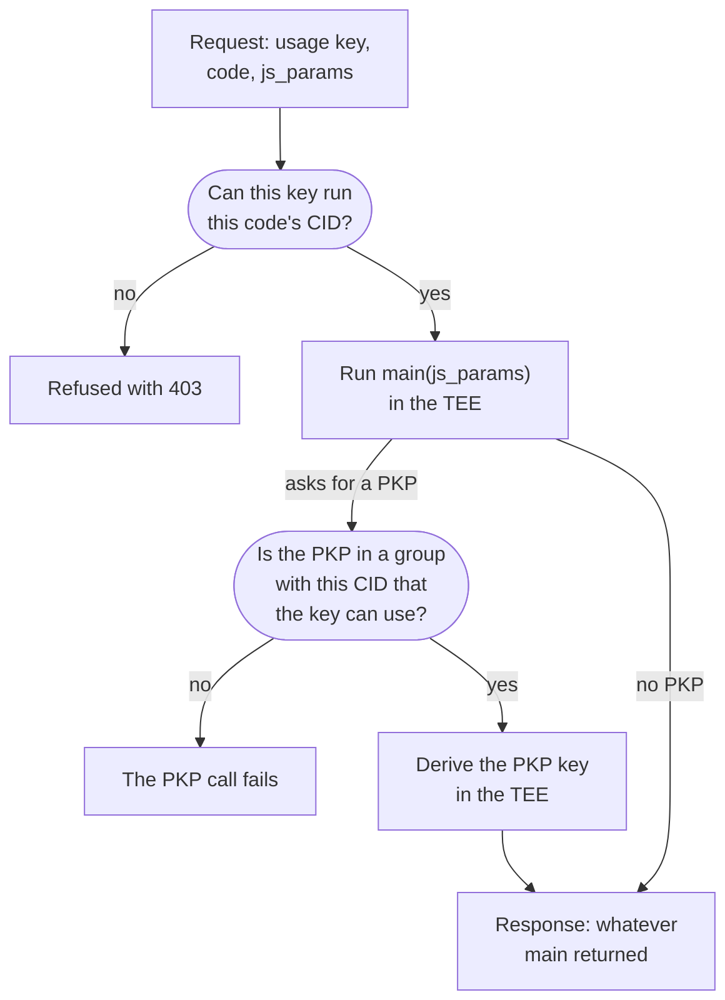

Every request takes this path. A group answers "Can this action use this PKP?" A usage key's scopes answer "Can this caller use this group?" A wildcard key (`execute_in_groups: [0]`) passes the first check for any code, but it still needs a group to use a PKP.
